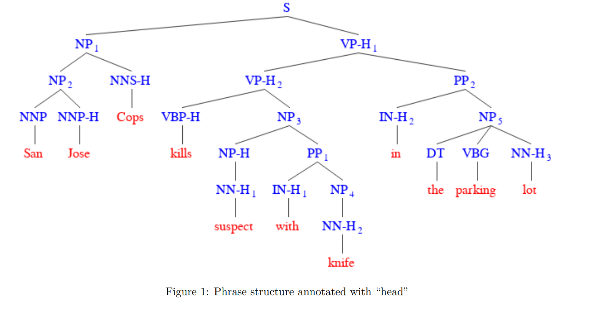
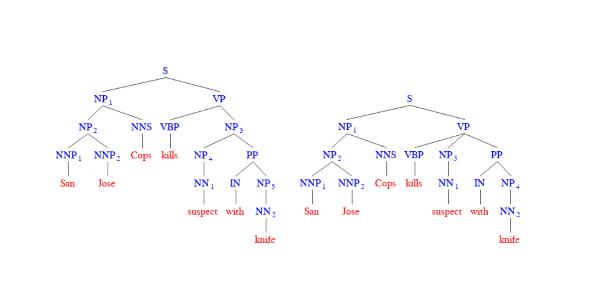

- braindump
	- creating palace blueprint in games #[[creative projects]]
		- sims
		- anno 1800
	- draw kyrie in a cute outfit
	- draw sohcahtoa ansatz viera
	- too many thoguhts about creating things. no desire to work.
		- [Too Many Thoughts Living Rent-Free In Your Head? Try Mind Gardening](https://www.refinery29.com/en-us/2022/04/10953988/mind-gardening-organize-thoughts-increase-productivity?utm_source=pocket-newtab) (25 APR 2022) by Sadhbh O'Sullivan
- summary
-
- cosi140b quiz review
	- MATTER cycle:  Explain each stage of the MATTER cycle is.
	- dev vs test set. why have both? (page 1)
	- Show the PDTB annotation for the following paragraph.
collapsed:: true
		- 1. John has a lovely evening.
		  2. He had a great meal.
		  3. He ate salmon.
		  4. He devoured cheese.
		  5. He won a dance competition.
	- temporal relations with underlined. three temproal anntoations: before, after, overlapping
collapsed:: true
	  Given the paragraph below, annotate the temporal relations between a minimal number of pairs of underlined events to construct a timeline between the events. The temporal relations you can used include “before”, “after”, and “overlap”:
		- “Two Travellers were on the road together, when a Bear suddenly **appeared** on the scene. Before he observed them, one **made for a tree** at the side of the road, and **climbed up** into the branches and **hid** there. The other was not so nimble as his companion; and, as he could not escape, he **threw himself on the ground** and **pretended** to be dead. . ”
	- sense of 'afford', given like six sentences, args, and tagging sents
collapsed:: true
		- So, the building **affords** artistic directors the freedom to conceive of almost any kind of activity underneath this floating object.
		- They just leased them – because they couldn’t **afford** to own the fancy cars
		- The reason that the electronic jellyfish worked as a lure is not because giant squid eat jellyfish, but it’s because this jellyfish only resorts to producing this light when it’s being chewed on by a predator and its only hope for escape may be to attract the attention of a larger predator that will attack its attacker and thereby **afford** it an opportunity for escape.
		- And that question is whether in this modern, globalized world we can really **afford** to have all these different languages.
		- Maybe they could **afford** a lock for the door and feel secure.
	- Write an algorithm that automatically converts phrase structure tree to dependency tree
collapsed:: true
	  Given the phrase structure tree in Figure 1 in which the head of each constituent is marked up with
	  “-H”, is it possible to automatically convert it to a dependency tree? Describe an algorithm about how to do this. For the purpose of this exercise, you can ignore the label that characterizes the relation between head and dependent of each dependency relation. Is there a way to deterministically convert the dependency tree back to the phrase structure tree? If not, why not?
		- 
	- Compute agreement btwn 2 phrase structure trees for the same sentence
collapsed:: true
	  there are two readings of a tree. one has PP as adjucnt the other has it has complement. i think the complement version was Gold. calculate the accuracy, prevision, recall, f1-score.
		- Compute the agreement between the following two phrase structure trees for the sentence “San Jose cops kills man with knife”. Assuming the first tree is the gold tree, what is the precision, recall, and F1-score? Make sure you demonstrate how the scores are computed.
		  
	- Universal Dependency annotation.
collapsed:: true
		- primacy of content words principle. one example of each as this principle applied to annotating (i) prepositional phrases, (ii) coordinating structures, and (iii) relative clauses. In what respect is the UD approach different from a “conventional” dependency annotation? What are its advantages and disadvantages, if any?
	- Cohen's Kappa btwn 2 annotators
collapsed:: true
		- Table 1 is an agreement table between two annotators. The numbers along the diagonal are the agreement numbers for each category. Compute Cohen’s Kappa between the two annotators. Make sure you demonstrate how Cohen’s kappa is computed step-by-step.
		  
		  |          | POS | NEG | NEU | Total |
		  | POS  |   25  |   3    |    2    |   30  |
		  | NEG  |    6   |   30  |    4    |   40  |
		  | NEU  |    4   |    7   |   19    | 30    |
		  | Total | 35 | 40 | 25 | 100 |
		  Table 1: The agreement table for two annotators
	- Fleiss' Kappa between annotators
collapsed:: true
		- Table 2 shows the agreement between four annotators for 5 items. Compute Fleiss’ Kappa between the annotators, and show a step-by-step procedure of how Fleiss’ Kappa is computated.
		  | Item | POS | NEG | NEU |
		  | 1 | 2 | 1 | 1 |
		  | 2 | 0 | 4 | 0 |
		  | 3 | 0 | 1 | 3 |
		  | 4 | 3 | 1 | 0 | 
		  | 5 | 1 | 2 | 1 |
		  Table 2: The agreement table for four annotators
- [[vocab]]
-