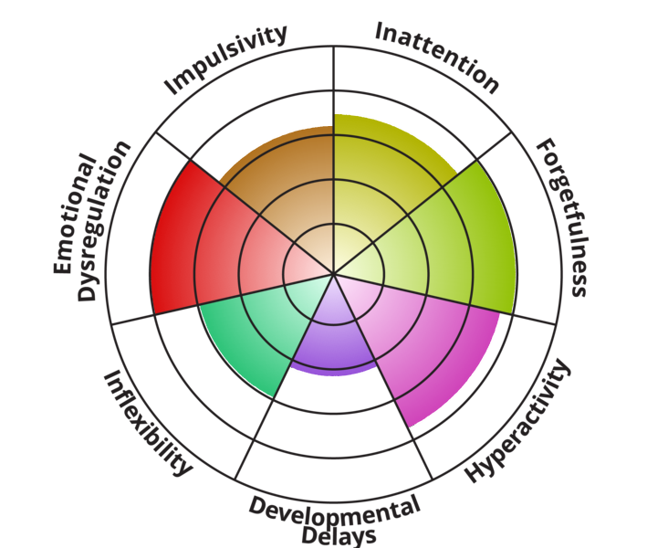
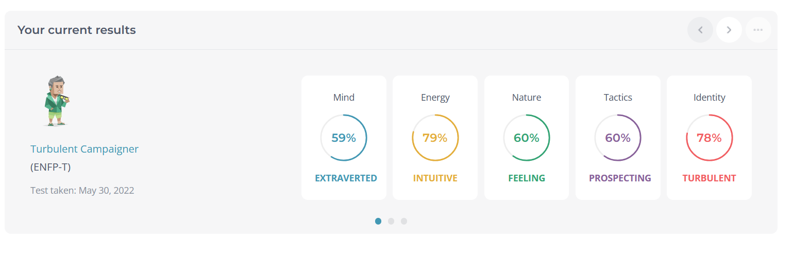
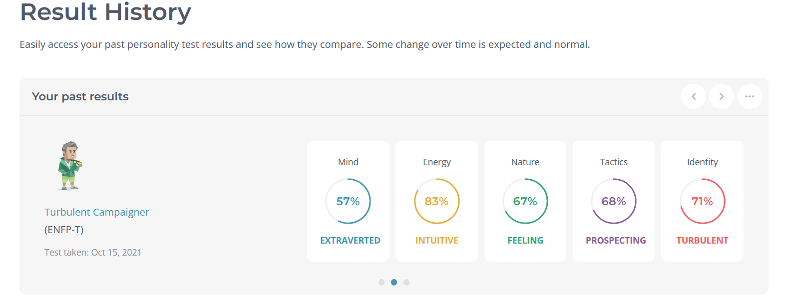
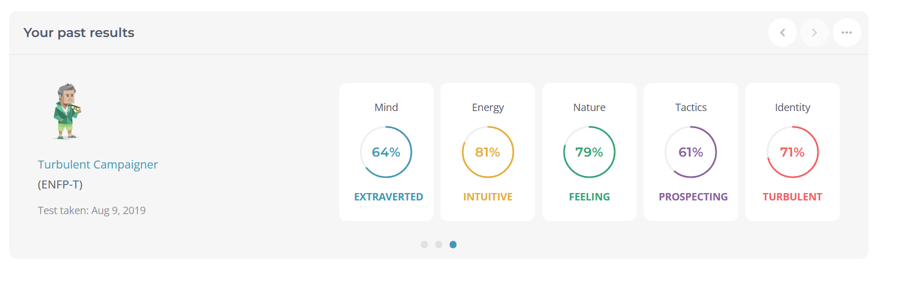

- brain-dump
	- #ADHD
		- 
	- #mbti and #[[cognitive functions]]
		- #enfp
			- [Inside the mind of the ENFP](https://youtu.be/j_ekr6UCBTY) #videos
collapsed:: true
				- extraverted iNtuItion
					- high-level milestones
					- insane associations
				- introverted FeelIng
					- this combined with NI makes you very idiosyncratic
				- extraverted Thinking
				- introverted SEnsing
					- dreaded details that come with logistics
					- lmaooooo it's not that ENFPs can't solve these, but don't respect them
					- lack of desire to put things to practice
					- the idea is the drug, the insight is the addiction --> the moment they tell you the entire idea, the life drains out of them
			- [The ENFP Analyst - A Different Perspective](https://youtu.be/l_g41Dsfnak) #videos
collapsed:: true
				- convergent stack Ne -> Te can sometimes make you lose track of your feelings / inner world
					- so absorbed in this pontification that makes us forget our place in the world at times
					- we like using externalized ways of thinking to coherently understand logic
					- Ne is a perceiving lens --> wide sense of reality at the expense of details (unless we develop Si), multiple components at once & pattern-seeking
					- various chains of causality compared with our understanding of the world
					- great improvisional capacity, take in stride an ever changing environment bc of ability to simulate different components
					- often well-suited to management, broad view of objective data
						- doesn't come up with plans for their own sakes
					- resent of authority: hates following instructions esp other ppl's frameworks and hierarchies
						- willingness to create their own order, antural ability to create their own systems to benefit other ppl (oftentimes) over the ones imposed upon them by other ppl
					- Te utility : oftentimes driven by highly humanitarian and altruistic agenda informed by our Fi
						- naturally independent, highly individualistic -- 'take me as i am'; relentlessly themselves
						- natural challenger
						- takes ona  cause, embodies that cause, often times something they thing will be benfificail to the world
						- Fi means this all comes a very empathetic source
							- often relies on other ppl to hold them to account; but v likely to take on too much responsibiliity; yes person
							- if they're not getting affirmation and respect and recognition from other ppl, makes it hard to pursue but they will do so anyway bc of high sense of duty
					- geared toward holistic planning
				- highly analytic type -- surveying and assigning objective values to observations in the world by creating systems
					- naturally systematic; gifted at enacting change upon the world
					- pursuing multiple different proejcts at the same time
						- likely to forget your own needs bc wanting to complete objectives in external world, do right by the needs of others
				- there is no Feeling or Thinking type -- this type of delineation makes it hard to identify with the descriptions given to us
					- so many ENFPS are highly introverted, withdrawn, analytical
					- cannot help but assign logic to waht they are perceiving, organize and understand reality
				- introverted sensing
					- highly ocncrete, highly specific
					- enfp doesn't act on kaleidoscope of confusing waves -- does not belong to an archetype
					- gazes into Fi with Si --> naturally in touch with who they are
						- healthy ENFPs can hone into their specific needs when they deattch themselves from their causes/projects
						- very likely type to engage in systematic exercise schedules
						- very liekly to take speific times out of their day to recharge (these are specific Si awareness)
						- emotions of ENFPs are intense, but v precise
				- not fluffy social butterfly -> v capable of achieving a deep level of analytical ability in any topic they choose to learn
				- can be very INFJ; but diff bc more concerned with humanity; life as a whole, existential concepts
					- both highly certain in their convictions and their convictions drive highly analytical agenda
					- concerned with understanding things internally, philosophically
					- likely to externalize this internal philosophy with diagrams or essays
			- in media
				- lilo
				- aang
			- {:height 234, :width 686}
			- 
			- {:height 162, :width 689}
			- Versatile, dynamic, and quirky, you are tireless in your pursuit of the untested, the untried, and the fight against the status quo. You love to interact with all kinds of people and you carry yourself in an expressive and warm manner that ideally sees lots of affirmation flowing both ways. Charismatic and imaginative, you tend to have a well-honed ability to see the world through the eyes of those who do not normally have an advocate to speak for them. You are interested in the potential of others and you often long to help them develop their own aspirations more fully. Ever-inquisitive and appreciative, you have a love of fantasy and adventure and are easily bored by the business-as-usual routines of the corporate and business world. Your own enthusiasm and energy for finding a new and better way arises spontaneously and can often be quite contagious. However, you tend to have little love for resolving the factual specifics of a case, preferring to work by pure inspiration and bursts of energy instead. 