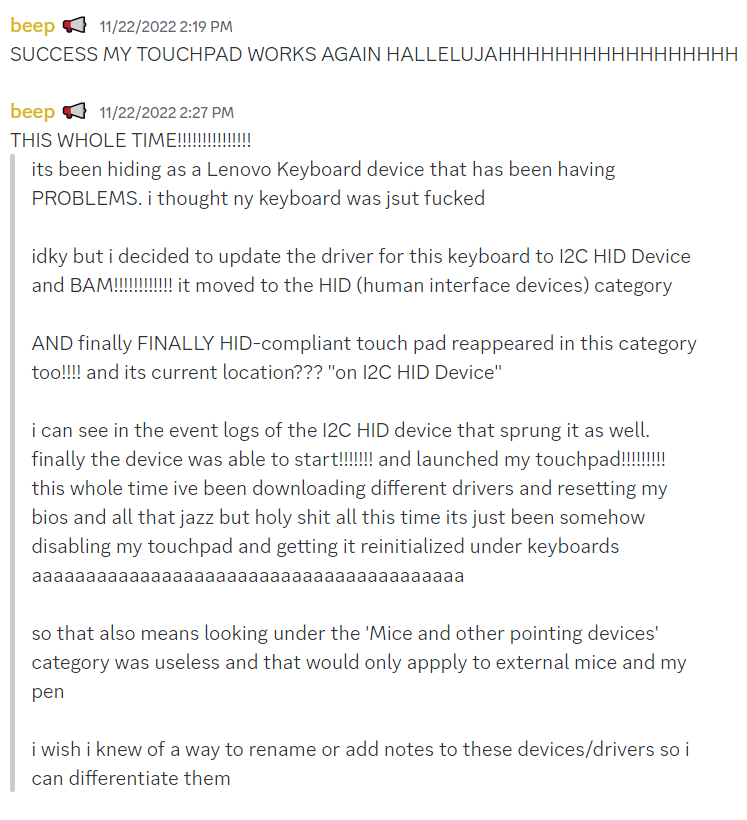

- #books _Consciousness Archaeology_ by Maximus Freeman
	- begins with a Caveat Emptor:
	  collapsed:: true
	  >>There is only one thing that I absolutely know for certain and that is that I know absolutely nothing for certain. Everything that you are about to read is nothing more than speculation -- nothing more than my current view of what calibrates as true to me in this present moment. As I continue to evolve, so will my views...
		- absolutely brilliant, literally me in every paper i write and every time i speak, this is prime meme material as a complete rejection of accountability lol
		- ^^emptor^^: (especially in legal usage) a person who purchases or contracts to purchase; buyer. #vocab
		- ^^caveat emptor^^: ĕmp′tôr noun The axiom or principle in commerce that the buyer alone is responsible for assessing the quality of a purchase before buying; a commercial principle that without a warranty the buyer takes upon himself the risk of quality #vocab
	- foreword
	  collapsed:: true
		- introduces a few #vocab words that Maximus Freeman 'intuitively' came up with while writing this book.
		- ^^belieflessness^^: not truly knowing anything for certain; 'practicing a complete absence of resistance to what is;' inability to form opinions about anything and the mystical awareness that comes from uncovery;
		- ^^consciousness archeology^^: our previously unexamined experiences and past lives through our consciousness and unconsciousness
		- ^^true worth^^: pure innocence; whole, complete;
		- ^^uncovery^^: the unlearning of preconceived notions and conditioned thoughts; the elimination of the shrouds of our core selves
	- prelude
	  collapsed:: true
		- thanks dr. hawkins for writing #books like *letting go*.
		- emotional non-resistance -- Hawkins, the Letting Go Mechanism
			- >>A feeling that is not resisted will disappear as the energy behind it dissipates.
			- feelings do not disappear forever. we just learn to handle them. and we each carry a large burden of negative emotions with us.
			- just let it play out. simply observe without wanting to fix it or do anything about it.
				- do not condemn or stifle or downplay or moralize or quiet. this will cause negative feelings to manifest as stress and frustration.
	- **book one: the uncovery of our true worth**
		- introduces the root of our pain and insecurities: #shame
		  id:: 63acd5f6-f2a1-4f51-99b3-a410ff3671e4
			- shame is born from a feeling of inadequacy. the worst form of it is feeling so inadequate that we do not deserve to love or to live.
			- when we are born, we are pure and unprogrammed. we do not have preconceived notions or conditioned thoughts about how a person ought to be, morality, or low self-worth.
				- this is belieflessness
			- our self-worth plummets when we cannot meet these expectations, causing us to feel unworthy and inadequate.
			- by addressing our feelings of shame, we can choose to not feel miserable when we don't meet expectations and instead return to true worth and belieflessness!
		- ((63acd76e-5e2a-4d38-a524-f707447cb185))
			- ((63a77b56-93c8-447d-98e6-93e4ae58b0bd))
			  collapsed:: true
				- ^^inline search^^: i made a `block reference` by typing `((title of block here))`. it starts a search of your entire graph
				-
			-
		-
	- my thoughts
	  id:: 63acd76e-5e2a-4d38-a524-f707447cb185
		- we are not limited by our beliefs at birth because we have not been introduced to judgement.
- #brain-dump
	- today my laptop has charged to 100%!!!! it worked!!!!
	  collapsed:: true
		- i was unsuccessful in taking apart my laptop to remove the battery.  the screws are tiny. chu Phuong has a set of those screws but he's in VN. dad wasn't home at the time and I didn't want him to buy a set.
		  collapsed:: true
			- side note: i am missing one screw in the back. could be the cause of some issues of the laptop. need to ask chu Phuong.
		- what i did:
		  collapsed:: true
			- 1. turn off laptop & unplugged from power source (the only thing that was keeping my 0% charged laptop alive)
			  2. held power button for 30 seconds. held it again for another 30 seconds bc i think i counted too quickly
			  3. turned laptop back on. (didn't happen bc no power). plugged charging cable back in and turned on again. 
			  4. appears nothing has changed and laptop was not charging. it still displayed 0%, said it was charging, and the orange power light was still on.
			  5. turned of laptop again. keeping the power cable in. 
			  6. held power button for 40 seconds. just to be sure.
			  7. turned laptop back on.
			  8. appears nothing has changed so i gave up and continued to use my laptop to play skyrim and fuck around for the next like seven hours
			  9. shut down computer before sleeping. left it plugged in.
			  10. this morning, to my delight, the power light has turned white! this usually indicates charge (no specification btwn 'above 20%' and 'fully charged')
			  11. excitedly turned on laptop. battery icon displays 100% fully charged! now i want to try unplugging my laptop but i am afraid. i also want to conservation mode but i am afraid. my laptop battery appears weak even tho i just replaced it this year.
			- previously i bought the lenovo healthy scan plan or whatever. it says it fixed like 23 issues but not the battery.
			- i also previously had issues with the trackpad. i don't know what caused it but earlier this semester of using my plug-to-play mouse, the trackpad stopped working and i could only use touchscreen or external mouse.
			- it took a lot of finagling with device manager. i tried uninstalling and reinstalling drivers, downloading random ones from the internet. doing a system reset. doing a windows os reset. i didn't want to wipe my programs. learned a lot about my laptop
			  collapsed:: true
				- for example: it has so many devices hidden.
				- there are supposed to be separate settings for your (a) mouse, (b) cursor, (c) trackpad.
					- really customized my cursor. i didn't know you could just download a fuckton of icon sets. i thought you needed a program or that this could only be done on websites (i was either missing myspace or was watching a myspace history video at the time). right now my cursor is a crosshairs in a circle and i really like having to center in on an object rather than click from the edge of pointer.
				- if you disable or uninstall the trackpad driver, it can literally disappear as a settings option
				- lenovo drivers suck. i mean, they just don't seem to be well-organized or interested in preserving older drivers. my device may become obsolete or unsupported very soon. disappointing.
				- lenovo help is ass. they do not respond. couldn't send in my laptop for a battery replacement last year.
				- basically i believe it was configured as a defunct lenovo keyboard device.
					- 
			- laptop has 2 cpu cores. it has a gpu but only for graphics and not for programming power. idk how that works yet
			- there are separate settings for audio. dolby access and dolby atmos or something. there are separate settings for intel audio too. basically my settings on the atmos thing were set to music. idk if i did that or it's default, but this was the root of some of my audio issues. dolby access also has presets for different media types. they are both not great without one another.
			- customized startup programs. learned there is a delayed launcher that enables some processes to launch after your initial boot up to reduce boot up time. disabled and delayed various programs to help my computer.
				- installed some timer program that reminds to take breaks. also re-installed rainmeter and anki. also got taskbarx to customize taskbar. created a customized folder that has a list of common programs i would like to use at the beginning of boot up but would slow me down a lot.
				- also google drive sync is p awesome. but needs to be delayed
				- same with nightlight or flux.io. choose one.
			- also ctrl + or ctrl - work in any program. not just web browsers. love being able to zoom in and out with any window.
		- i just unplugged laptop from power source. let's see if i can charge it again later after using up the power.
- taking notes on books --> [How I take notes from books in Logseq](https://www.youtube.com/watch?v=yJ8PeW0_NT0)
  id:: 63acc7bc-a5d6-4936-b13f-d60e12de01c0
	- before deciding on a system
	  collapsed:: true
		- Why? To inform ho wmuch effort you whould put into this.
		- What is the output for me?
			- Pure retrieval (low effort, some tagging)
			- Output of a newsletter (medium effort)
			- Knowledge synthesis (high effort)
		- Do I just want to enjoy the book and have a relaxing read?
		- How can I make this low friction / pleasant?
			- Think about ease of access / rediscoverability
			- Formatting
		- Reading and productivity attitudes
			- beware of toxic behaviours
			- the idea of a "should read" checklist is a fallacy
				- yes there is an achievement aspect that comes from reading books, but unto what end?
	- thinking about frameworks
		- what are others using?
		  collapsed:: true
			- CODE: collect, organize, distill, express
				- progressive summarization methodology
			- Read, Highlight, Record, Synthesize
			- Magical insight logging frame work
		- entering notes into a #[[PKM]] system
			- capture
				- writing things in your own words
					- generally improved synthesis
					- forces you to challenge the ideas, not just copy them
				- highlight and export
			- organizing and synthesizes
				- [OneStutteringMind example](https://www.youtube.com/watch?v=yJ8PeW0_NT0&t=686s)
				- [using block references](https://www.youtube.com/watch?v=yJ8PeW0_NT0&t=809s) -- whatever i write in this point gets updated in the reference
				  id:: 63acca68-5005-45b3-8e75-2023469498cd
					- you actually need to alt-clickhold-drag bullet point into another page
			- tradeoff of time and effort!
- #[[tv show]] obi-wan kenobi
	- s1e1 pilot | 3/10
		- nice music, relies on main themes
		- pretty slow for a straight-forward set-up
		- would like to see more of obi-wan contemplating it for real. he kinda just goes back because duty calls. i guess tha's obi-wan for you.
		- i like the world-building. scenes with luke and leia. leia actress is cute and delivers lines well.
		- the grand inquisitor's speech in the opening was the best part. actually scary. felt non-disney.
		- i liked the silent traveling with obi-wan to his dwelling. lots of implied meaning. you can figure it out on your own.
		- didn't really need a recap of the first three movies. esp if you're gonna do a dream sequence later. would rather spend time with obi-wan's reaction than the dream sequence itself.
			- one of the saddest points in the episode: 'Master Qui-Gon...?'
			- his eyes...
			-