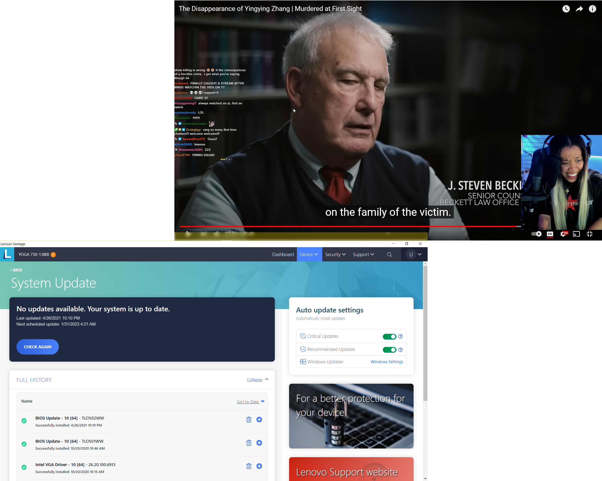

- i really wanna program! and be a cool-ass computer scientist!!!!!!!!!
- 
- stargazerlilly ill send the $7 for the bullets.
	- firing squad what the fuckkkk
	- cheeks up, rat!h
	- hands up, pants down!
	- slow down, grab the wall
	- get on the ground and arch your back!
- the peace one gets from funeral. getting the person's remains.
	- what does it say to us to uneath the pyramids and shit?
	- ### 06:00  yingying zhang urbana champagne
	- **06:00**  survivor's guilt with emily hogan, former student, would have been the first victim
	- her last sentence in her journal. 'life is too short to be ordinary.' journal returned to her mom
	- desperately sorry. she wishes she could have done more for them. but its not her fault! she did all the things right. she went on fb, she posted a notice abt creepy behaviour. she notified the police.
-
- ### 08:45
	- i'm worried that i can't do anything or i will lose my interest in pursuing knowledge and i wont go as far. like my thirst and joy for learning will die. run dry. unquenched. just neglected. my heart!
	- cj the x is seriously messing with my brain hemistry. i want to create beauful code and documents and cutting edge techmnology and funny funny funny art and helpful.
	- i have a voice!
	- i dont have to do smth novel and amazing and profitable and matching someone elses markers of success without the actualy quality of successs. i just need to release projects! i can only get experience by doing tha. rn i am ARMCHAIR ARTISTING!!!!!!!!!!!!
- **08:49**  i feel a little bit betrayed by boze for suggestion 10 to LIFE channel even tho she is someone who HEAVILY speculates like a gossip channnel. she's better than other channels ethically but it's the same behaviour. i was fooled inot thinking she cared / respected true crime as much as you did.
- **08:50**   every time i actually begin to look into computer science or math i get scared. of advancing. i am scaed of studying. why! i am being blocked!!!
- **08:51**   understandign this blockage will be a lot of reflection. #blockage
	- bu t i think it is good that we have now identified it. we are getting more positive and healthy impulses:
		- clean
		- cook
		- beautiful tthe spac
		- be clean yourself
		- check in with people
		- dance
		- sing
		- listen to music
		- sit in the sun
		- yay!!!!!!!
	- but we need to acutally plan these down (or at least capture them semwhere) to take effective action!
	- however that does not mean we havent been doing lots. we are! yay for us. these suggestions are optimizations to help us. not a criticize
-
- **08:58**   markmanson. learning can feel like progress even when it's not progress.
- **09:13** gdi i love the white lotus and this new willow album slaps
	- [The White Lotus - The Power Dynamics of Relationships - YouTube](https://youtu.be/ubWvAjh0ABg)
- **09:17** we never tell each other the most painful words. it's btwn the lines that we *uncover* what the other person is hiding from specifically us?
- **09:18**  the truth is no longer important to us. the freezing out. the secret keeping .the divvying up of information. human interaction. there is so much that chagnes in our dialgoue depending on what we want and who we're tlaking to. wild!
-
- ### 09:50  semantics the phantom god behind all conflict
-