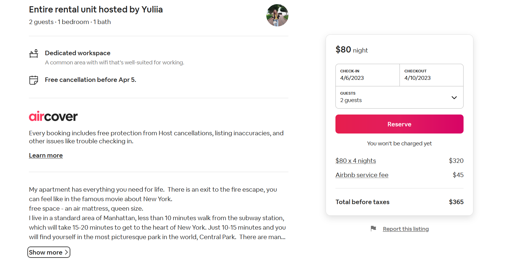
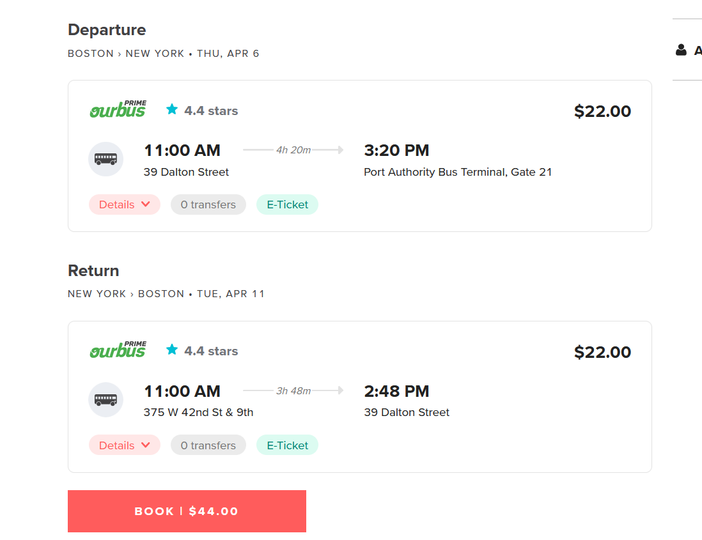
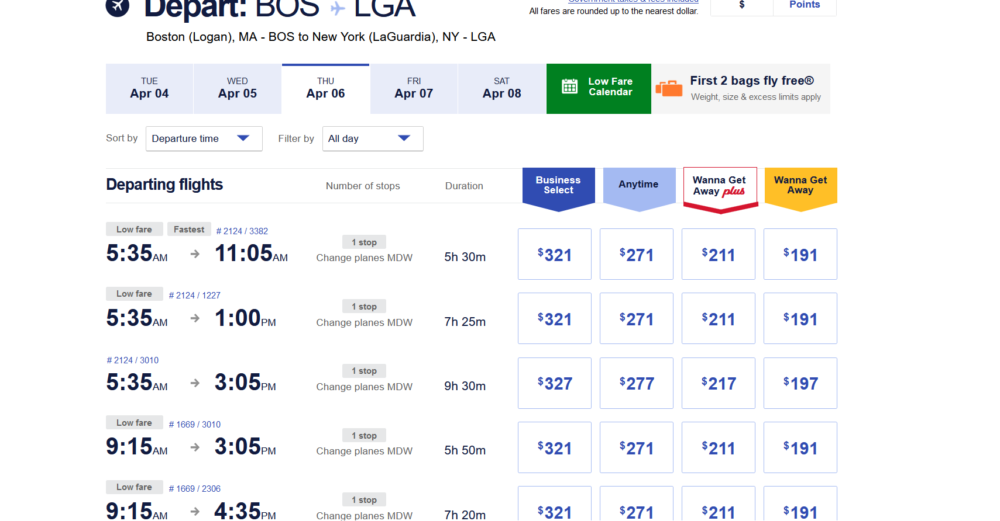

- spring break April 5-13 nyc?
	- 
		- [Apartment for just full period 6-13th April - Apartments for Rent in New York, New York, United States - Airbnb](https://www.airbnb.com/rooms/845120455262584469?check_in=2023-04-06&check_out=2023-04-10&guests=1&adults=2&s=67&unique_share_id=32ee0f1e-193f-4259-961c-4bbee222b6ab)
	- 
	- flights are expensive and VERY LONG
		- 
- cooking with boze stream
	- when to sear?
	- egg slightly runny boil on high in 7 mins
- instacart was great today
- #python #cli
	- 1.  ### Jarooomihooi _—_ Today at 6:48 PM
		- Does anyone know how to quickly set up a python file to take in arguments from command line ... aaaand what about running in Pycharm, and letting it run(by clicking the run button) with default arguments? Like lets say I want to run this in Pycharm: pytest test_a.py -v But if I hit run, it won't have the -v
	- 2. ### christeenie (she/they) _—_ Today at 8:23 PM
		- the second half of this article might cover what you're asking about. need to define your own parser that takes the arg "-v" and outputs your own "verbose" version fo the result to be printed into the terminal... [[Page not found – OpenSourceOptions](https://opensourceoptions.com/blog/how-to-pass-arguments-to-a-python-script-from-the-command-line/](https://opensourceoptions.com/blog/how-to-pass-arguments-to-a-python-script-from-the-command-line/) "[How to Pass Arguments to a Python Script from the Command Line – OpenSourceOptions](https://opensourceoptions.com/blog/how-to-pass-arguments-to-a-python-script-from-the-command-line/")) code & explanation: [[Page not found - Stack Overflow](https://stackoverflow.com/questions/5980042/how-to-implement-the-verbose-or-v-option-into-a-script](https://stackoverflow.com/questions/5980042/how-to-implement-the-verbose-or-v-option-into-a-script) "[python - How to implement the --verbose or -v option into a script? - Stack Overflow](https://stackoverflow.com/questions/5980042/how-to-implement-the-verbose-or-v-option-into-a-script")) (edited)
	- [Understanding Command Line Arguments and How to Use Them](https://www.bleepingcomputer.com/tutorials/understanding-command-line-arguments-and-how-to-use-them/)
- docker & vscode for microsoft dev?
- linux on ubuntu programming?
- #java #chatgpt
	- To learn Object-Oriented Programming (OOP) in Java, you can follow these steps:
	  collapsed:: true
		- 1.  Learn the basics of Java: Before you can dive into OOP, you need to have a good understanding of the Java language itself. Learn the syntax, data types, control structures, arrays, loops, and functions in Java.
		- 2.  Understand the OOP Concepts: As mentioned earlier, OOP is based on several key concepts such as encapsulation, inheritance, and polymorphism. You need to have a solid understanding of these concepts and how they apply to Java programming.
		- 3.  Learn about Classes and Objects: In Java, classes and objects are the building blocks of OOP. Learn how to create classes, define their attributes, and create objects from them.
		- 4.  Learn about Inheritance and Polymorphism: Inheritance is a key OOP concept in Java, which allows you to create new classes based on existing ones. Polymorphism refers to the ability of objects to take on multiple forms. Learn how to implement inheritance and polymorphism in Java.
		- 5.  Practice with Examples: The best way to learn OOP in Java is to practice writing code. Start with simple programs and gradually work your way up to more complex ones. Try to create classes, objects, and methods using the OOP concepts you have learned.
		- 6.  Read Java Programming Books: There are many excellent Java programming books available that cover OOP concepts in depth. Some popular ones include "Head First Java" by Kathy Sierra and Bert Bates, "Java: A Beginner's Guide" by Herbert Schildt, and "Effective Java" by Joshua Bloch.
		- 7.  Take Java OOP Courses: There are many online courses available that cover OOP concepts in Java. Some popular ones include "Java OOP Principles and Patterns" on Udemy, "Object-Oriented Programming in Java" on Coursera, and "Java Programming and Software Engineering Fundamentals" on edX.
	- There are several ways to visualize Object-Oriented Programming (OOP), depending on the type of visualization that works best for you. Here are a few examples:
	  collapsed:: true
		- 1.  UML Diagrams: UML (Unified Modeling Language) diagrams are a common way to visualize OOP. UML diagrams are graphical representations of the classes, objects, and relationships in an OOP program. There are several types of UML diagrams, including class diagrams, sequence diagrams, and use case diagrams.
		- 2.  Mind Maps: Mind maps are a visual way to organize information and ideas. You can use a mind map to visualize the relationships between classes, objects, and methods in an OOP program. Start by creating a central idea for your program, and then branch out to create sub-ideas for each class and method.
		- 3.  Flowcharts: Flowcharts are another way to visualize the flow of control in an OOP program. You can use a flowchart to represent the sequence of steps that a program takes to accomplish a specific task. Each step can be represented as a box, and arrows can be used to show the flow of control between the boxes.
		- 4.  Code Visualization Tools: There are several tools available that can help you visualize your code in a graphical way. Some of these tools include Code City, Code Bubbles, and BlueJ. These tools allow you to see your code as a collection of classes, objects, and relationships.
		- 5.  Drawing Tools: Finally, you can use any drawing tool, such as a whiteboard, pen and paper, or digital drawing software, to sketch out your OOP program. This is a quick and easy way to visualize your program and make changes on the fly.
		- In summary, there are many ways to visualize OOP, including UML diagrams, mind maps, flowcharts, code visualization tools, and drawing tools. The key is to find the method that works best for you and allows you to better understand and communicate your OOP program.
	- Sure, I'll do my best to visualize an implementation of a linked list in Java. Here are the steps I would take:
	  collapsed:: true
		- collapsed:: true
		  1.  Define the Node Class:
			- The first step in implementing a linked list is to define a Node class that represents each node in the list. Each Node object should contain two fields: one to hold the data and another to hold a reference to the next node in the list.
			- Here is an example implementation of the Node class:
			  collapsed:: true
				- ```java
				  public class Node {     
				  	int data;     
				  	Node next;
				  }
				  ```
		- collapsed:: true
		  2.  Define the LinkedList Class:
			- Next, we need to define the LinkedList class that will contain the nodes. The LinkedList class should have a reference to the first node in the list, which is often called the head.
			- Here is an example implementation of the LinkedList class:
			  collapsed:: true
				- ```java
				  public class LinkedList {     
				  	Node head; 
				  }
				  ```
		- collapsed:: true
		  3.  Implement the Insertion Methods:
			- The next step is to implement methods that can insert nodes into the linked list. There are several ways to insert nodes into a linked list, but two common methods are inserting at the beginning of the list and inserting at the end of the list.
			- Here are example implementations of these two methods:
			  collapsed:: true
				- ```java
				  public void insertAtBeginning(int data) {
				    Node newNode = new Node();     
				    newNode.data = data;     
				    newNode.next = head;     
				    head = newNode; 
				  }  
				  ```
				  ```java
				  public void insertAtEnd(int data) {
				    Node newNode = new Node();     
				    newNode.data = data;     
				    newNode.next = null;     
				    if (head == null) {         
				      head = newNode;     
				    } else {         
				      Node current = head;         
				      while (current.next != null) {
				        current = current.next;
				      }         
				      current.next = newNode;
				    }
				  }
				  ```
		- collapsed:: true
		  4.  Implement the Deletion Method:
			- We also need a method to delete nodes from the linked list. One common method is to delete the first node in the list.
			- Here is an example implementation of the deleteFirst method:
				- ```java
				  public void deleteFirst() {
				    if (head != null) {
				      head = head.next;
				    }
				  }
				  ```
		- 5.  Test the Linked List:
			- Finally, we can test the linked list by creating a LinkedList object, inserting some nodes, and then printing out the contents of the list.
			- Here is an example of how to do this:
			  collapsed:: true
				- ```java
				  public static void main(String[] args) {
				       LinkedList list = new LinkedList();
				       list.insertAtBeginning(3);
				       list.insertAtBeginning(2);
				       list.insertAtBeginning(1);
				       list.insertAtEnd(4);
				       list.deleteFirst();
				       Node current = list.head;
				       while (current != null) {
				           System.out.println(current.data);
				           current = current.next;
				       }
				   }
				  ```
	- Sure, here's a flowchart for the code implementing a linked list in Java:
	  collapsed:: true
		- flowchart
		  collapsed:: true
			- ```sql
			  START
			  |
			  v
			  Create LinkedList object
			  |
			  v
			  Insert node with value 3 at beginning of list
			  |
			  v
			  Insert node with value 2 at beginning of list
			  |
			  v
			  Insert node with value 1 at beginning of list
			  |
			  v
			  Insert node with value 4 at end of list
			  |
			  v
			  Delete first node in list
			  |
			  v
			  Set current node to head of list
			  |
			  v
			  while current node is not null:
			  |   |
			  |   v
			  |  print value of current node
			  |   |
			  |   v
			  |  set current node to next node
			  |
			  v
			  END
			  ```
		- I hope this helps you visualize how the code for the linked list works!
	- Sure! Here's a flowchart that illustrates the relationships between the Node and LinkedList classes in the implementation of a linked list in Java:
	  collapsed:: true
		- flowchart
		  collapsed:: true
			- ```sql
			  START
			  |
			  v 
			  Node class 
			  | 
			  v 
			  int data 
			  | 
			  v 
			  Node next 
			  | 
			  v 
			  LinkedList class 
			  | 
			  v 
			  Node head 
			  | 
			  v 
			  insertAtBeginning() method 
			  | 
			  v 
			  insertAtEnd() method 
			  | 
			  v 
			  deleteFirst() method 
			  | 
			  v 
			  main() method 
			  | 
			  v
			  END
			  ```
		- explanation
		  collapsed:: true
			- The Node class has two fields, `data` and `next`, which represent the data stored in the node and a reference to the next node in the list, respectively. The LinkedList class has a single field, `head`, which represents the first node in the list. The `insertAtBeginning()`, `insertAtEnd()`, and `deleteFirst()` methods operate on the nodes in the linked list by modifying the `head` and `next` fields. Finally, the `main()` method creates a LinkedList object and calls the various methods to insert and delete nodes, and then prints out the contents of the list.
			- I hope this flowchart helps clarify the relationships between the classes in the implementation of a linked list in Java!
	- Sure, here's a visualization of a linked list:
	  collapsed:: true
		- ```css
		  [HEAD] -> [Node1] -> [Node2] -> [Node3] -> [TAIL]
		  ```
		- In a linked list, each node contains a value and a reference to the next node in the list. The first node in the list is called the head, and the last node is called the tail. In the visualization above, the arrow (->) represents the reference to the next node.
		- For example, if we have a linked list with the values 1, 2, and 3, the visualization would look like this:
			- ```css
			  [HEAD] -> [1] -> [2] -> [3] -> [TAIL]
			  ```
		- Here, the head node does not contain a value, but only a reference to the first node in the list (1). The tail node also does not contain a value, but only a null reference to indicate the end of the list.
		- I hope this visualization helps!
-