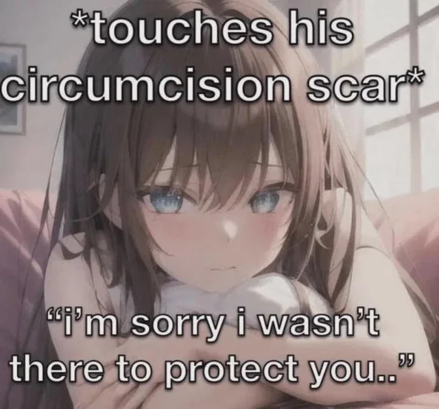

- nsfw
  collapsed:: true
	-
	- 
- "sweetener" is my favourite album, a sweet treat when i needed it. hah. it's the album that got me into her music. i prefer to listen to one album at the time all the way through and i found "thank you, next" a weird album sonically and lyrically, though i understand she was undergoing a internal transformation. the magical tracks that keep me coming back don't outshine the more toxic hits. i also disliked like her "blaccent" era and louder fixation on material items. i couldn't finish "yes, and" past the first chorus, it struck me as tone-deaf. i found out later about the scummy lyrics in the bridge. i agree that this song was a flop for her, it would be received better under different circumstances. it's also just...not that interesting, there are many empowerment anthems that do what this track wanted to do but better.
- edited:
  "sweetener" is my favourite album, a sweet treat when i needed it. hah. it's the album that got me into her music. i prefer to listen to one album at the time all the way through and i found "thank you, next" a weird album sonically and lyrically, though i understand she was undergoing an internal transformation. the magical tracks that keep me coming back don't outshine the more toxic hits. i also disliked like her "blaccent" era and louder fixation on material items. i couldn't finish "yes, and" past the first chorus, it struck me as tone-deaf. i found out later about the scummy lyrics in the bridge. i agree that this song was a flop for her, it would be received better under different circumstances. it's also just...not that interesting, there are many empowerment anthems that do what this track wanted to do but better. 
  
  i agree with you that criticism toward her life has eclipsed that toward her music. it's wrong for radical fans to want to control their favourite pop star. i think people are missing the point and are obsessed with idolization and cancellation. 
  
  i think she has some underlying issues she hasn't addressed for herself. not for social media, not for the big wigs, not for the people in her inner circle. truly for herself. i do not hate her and i wish the best for her. i'm sure she would have preferred to have an unproblematic love life and maybe right now feels like she's dug herself into a deep hole. i don't think people act like this when they're doing okay. in many of her songs (especially from both "sweetener" and "thank you next"), ariana expresses difficulty with taking care of her mental health and how being in the public eye exacerbates her anxiety. i think that would also explain her recent physical transformations and addressing comments about her body. i wonder if she feels pressure to have everything figured out because she's financially successful and "should" be happy and healthy but struggles with relationships. she has had many devastating moments that have no doubt scarred her and she just might not have the tools to climb herself out of said hole. ofc she has the money for all the therapy in the world, but the healing takes time and isn't linear. this might be one of those non-linear moments. in that case, it's best for the rest of us to give words of kindness or to stay silent.