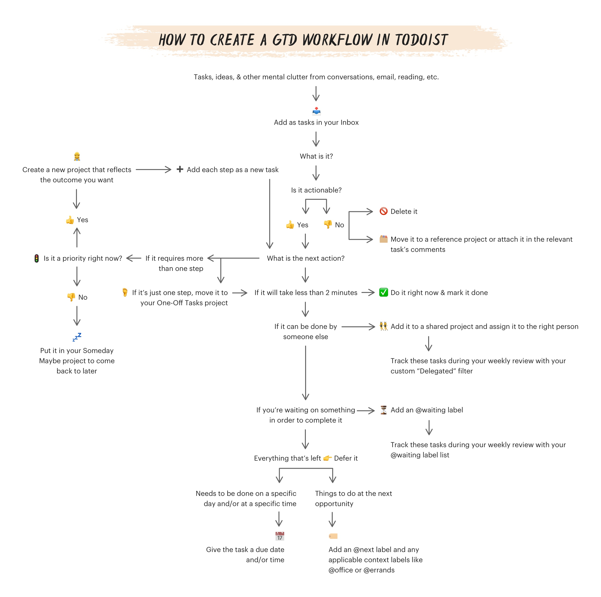

- [getting things done](https://todoist.com/productivity-methods/getting-things-done)
- Getting Things Done, or GTD for short, is a popular task management system created by productivity consultant David Allen. The methodology is based on a simple truth: The more information bouncing around inside your head, the harder it is to decide what needs attention.
- intended audience
	- ppl who feel overwhelmed by their responsibilities
	- perfectionists
	- ppl who wear lots of hats in their life and job
	- ppl who have trouble following thru
	- losers
- 5 simple steps to a more productive life
	- capture: anytihng that crosses ur mind
		- inbox for chaos collecting
		- initial mind sweep of all ['open loops'](https://gettingthingsdone.com/wp-content/uploads/2014/10/Mind_Sweep_Trigger_List.pdf) that might need actions taken soon
		- dump new tasks right away from brain to inbox
		- consolidate inboxes for fewer open loop checks
		- capture reading & reference material
	- clarify: process captured items into clear & concrete action steps (project, next action, or reference)
		- label chaotic clutter as one of the following:
			- right away: takes <2 mins
			- project: task requires more than one step
			- delegate: send 2 someone else
			- non-actionable reference: file in new reference project or attach to current relevant task/project
			- schedule: has a deadline imposed & needs a date
			- delete: no longer needed or actionable
		- 
		- specific actionable tasks, including any documents/references/comments as needed
	- organize: put things where they belong. add relevant detail. delegate. file away. sort
		- technically occurs while cleaning out inbox
		- one-off tasks
		- projects
		- areas of focus
		- next actions
		- tasks with a due date / time
		- agendas
		- reference materials
		- waiting for
		- someday/maybe
		- delegate
		- contexts
	- engage w/ fewer choices & fewer resources to find
		- today view to hourly overview
		- upcoming to visualize and plan ahead
		- viet next actions and contexts
		- create mroe custom task views with filters and queries
	- review: frequently review, update, revise lists
		- weekly: look over all lists, organize tasks, maintain smooth system
			- mayeb make a template fo rurself
			- schedule this review to make sure u do it
		- refocus, identify next actions, adapt, reflect
	- engage: done planning. now follow it.