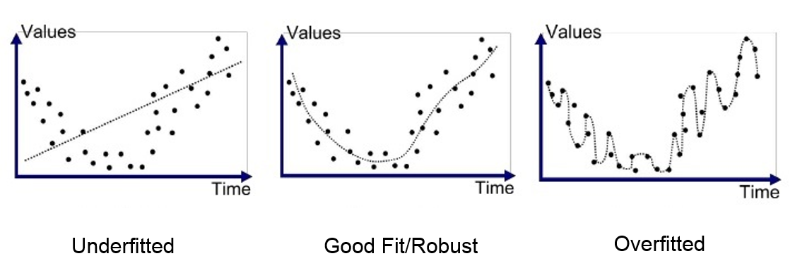
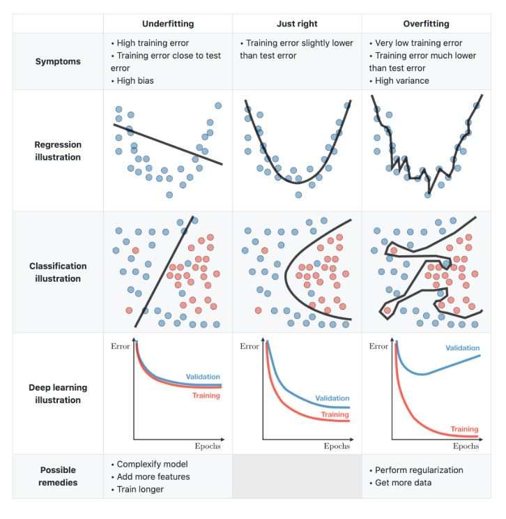

title:: [COSI 134A] PA1: Train a Logistic Regression model for text classification from scratch

- tasks
	- **Representation**
		- choose _feature set_
			- small feature set that will run quickly and is easy to debug
			- ramp up # and variety of features after thoroughly testing code
		- choose _data structure_ to hold _features_
			- recommended: sparse feature vectors (i.e.: numpy ndarray)
				- let's scratch the tensor idea for now
			- cache features internally within each Document object
				- the algorithm is iterative so it is impt that featurization is only executed once
		- choose _data structure_ to hold _parameters (weights)_
			- recomended: k x p matrix where k = num of labels, p = num of ling features
				- equivalent to vector of length k X p
	- **Learning**
		- compute negative log-likelihood function for each minibatch of data
			- this function tracks the progress of the parameters' fit to the data
		- compute gradient wrt parameters
			- the gradient is used to update the parameters (one data structure of parameters for all the data) for each minibatch of data
		- implement mini-batch graident descent to train model & find best parameters
			- gradient descent learns the parameters by iteratively updating a chunk of data and its gradient
	- **Classification/Inference**
		- predict a single data instance
	- **Experiments**
		- (1) Training set size {1000, 5000, 10000, all}
		- (2) Minibatch size {1, 10, 50, 100, 500}
		- (3) Hyperparameter tuning \lambda = {0.1, 0.5, 1.0, 10.0} for L_2 regularization
		- (4) Feature engineering (extra credit for creative and effective features)
	- **Submission**
		- Code w/o datasets
		- Report (single-spaced <= 3 pages, including graphs)
			- (1) Brief explanation of code structure
			- (2) How to run your code, what output to expect
			- (3) Experimental settings
				- explain clearly what feature set is being used
				- explain clearly how you set up minibatch gradient descent
			- (4) Experimental results
	-
	- **variations of gradient descent** info
		- **batch gradient descent** requires calculating gradient from the entire data set for every update
			- \code
			  while not converged:
			      gradient = compute_gradient(parameters, training_set)
			      paramaters -= gradient * learning_rate
		- unecessary, we can approximate the gradient of the batch gradient descent by computing the gradient from smaller subsets of the data
			- this is **minibatch gradient descent**
				- while not converged:
				      minibatches = chop_up(training_set)
				      for minibatch in minibatches:
				          gradient = compute_graident(parameters, minibatch)
				          parameters -= gradient * learning rate
				- practical issues of minibatch gradient descent:
					- how should parameters be initializaed for the first iteration?
						- set them all to 0 for logistic regression
							- not advisable for more complciated models (underflow due to dividng by 0...?)
					- how do i introduce the bias term?
						- include a feature that fires in all data instances and treat it s a normal feature
					- why do the calculations for hte posterior P(Y|X) become NaN?
						- probably exponentiated some big number and divided by the same amount
							- i.e.: 
							  posterior = exp(unnormalized_score_i) / sum_j(exp(unnormalized_score_j))
						- work around trick:
							- posterior = exp(unnormalized_score_i - scipy.misc.logsumexp(unnormalized_scores))
						- "...we are quite confident that you will need to use the logsumexp function" [here is an explanation](https://gregorygundersen.com/blog/2020/02/09/log-sum-exp/)
							- this is known as normalizing vectors of log porbabilities
							- logarithmic scale for stat modeling
								- prevents underflow when handling extremely small numbers getting multiplied by converting to addition
								- numerically safe and many standard libraries compute probability density functions (PDFs) by simply exponentiating log PDFs
								- also applies to functions:
								  derivative wrt x log[f(x)g(x)] = derivative wrtx log(f(x)) + derivative wrt x log(g(x))
								- when log-scale values are too large, we want to normalize by computing:
								  exp(x_m) / sum(n=1:N) exp(x_n) = 1
									- each x_n could be an extremely large or extremely small log probability that is either negative or positive, which could cause under-/overflow when expoenntiated
									- if a value x is in (0,1), then log(x) must be negative
									- we use the log-sum-exp operation to be able to interpret quantities as probs even if they are outside of the range (0,1)
								- log-sum-exp function:
								      LSE(x_1, ..., x__N) = log (sum(n=1:N) exp(x_n))
									- how to derive from the previous normalization function:
									  id:: 632ca81a-c68d-42a4-a859-5dc1f47701a8
									  exp(x_m) = sum((n=1:N) exp(x_n))
									  x_m = log (sum((n=1:N) exp (x_n)))
									  0 = x_m - log (sum((n=1:N) exp(x_n)))
									  1 = exp (x_m - log(sum((n=1:N) exp(x_n)))
									                          ^ this log section is LSE(x_1, ... x_n)
									- further derivation:
									  y = log (sum((n=1:N) exp(x_n)))
									  e^y = sum((n=1:N) exp(x_n))
									  e^y = e^c sum((n=1:N) exp(x_n - c))
									  y = c + log(sum((n=1:N) exp(x_n -c)))
									- we can shift the values of the exponent by arbitrary constant c (we can subtract the c because of how e^(x_n - c) would be like e^(x_n) - e^c)
									- then we gurantee that the largest positiv exponentiated term is exp(0 = 1) by setting c = max{x_1, ..., x_n}
									- def logsumexp(x):
									      c = x.max()
									      return c + np.log(np.sum(np.exp(x - c)))
									- normalization trick with log-sum-exp function:
									  logsumexp(x)
									  logsumexp(x)
									  -> 1001.0986122886682
									  np.exp(x - logsumexp(x))
									  -> array([0.33333333, 0.33333333, 0.33333333])
									-
								- overflow example:
								  x = np.array([1000, 1000, 1000])
								  np.exp(x)
								  -> array([inf, inf, inf])
									- normalizing x wiht the regular function is impossible and would either crash as inf or NaN
								- underflow example:
								  x = np.array([-1000, -1000, -1000])
								  np.exp(x)
								  -> array([0., 0., 0.])
								  np.exp(x - logsumexp(x))
								  array([0.33333333, 0.33333333, 0.33333333])
								- wide range of values example:
								  x = np.array([-1000, -1000, 1000])
								  np.exp(x - logsumexp(x))
								  array([0., 0., 1.])
									- the probability of the first two components are not actually truly 0 but this is a good enough approxmiation for what those log porbabilities should represent w/ numerical stabliity
							-
							-
					- How do you know when the model converges?
						- convergence (in mathematics): property of approaching a limit more and more closely as a variable of the function icnreases or decreases as the number of terms of the series increases
							- ex: y = 1/x converges to zero as x gets bigger
						- extremely difficult to tell
						- stopping the model's training too early can cause underfitting
							- underfitting: the model has not reached its peak (local min/max depending on which function you use)
						- stopping the model's training too late can lead to overfitting
							- overfitting: the model fits too well to the training set and cannot generalize unseen data; visualization: the model just plots the actual data points rather than estimating
collapsed:: true
								- 
								- 
								-
						- recommendation: _early stopping_, evaluating the model on the develop set during gradient descent and saving the set of parameters (a snapshot of the current weights) if the evalutation  shows better performance with them than with the previous parameters
							- finally stop training once performance appears to plateau and no longer improves after a number of updates
								- you decide your stopping point
							- use the last saved parameters to do predictions
						-
					- How often should I run evaluation on the dev set during training?
						- up to you; you could even evaluate on dev for every single update to the parameters
					- how do i know that my implementation is correct?
						- look at avg neg log-likelihood method:
							- gradient should get closer and closer to zero
							- neg log-likelihood should decrease monotonically (i.e.: at every single update)
								- monotonically: behaviour of one variable determined by behaviour and direction of another variable (monotonically increasing: graph only icnrases when values of equation increase; decreasing if values are only decreasing)
		- stochastic gradient descent: computes gradient of one data instance for each update
			- while not converged:
			      for datapoint in training_set:
			          gradient = compute_gradient(parameters, datapoint)
			          parameters -= gradient * learning_rate
		-